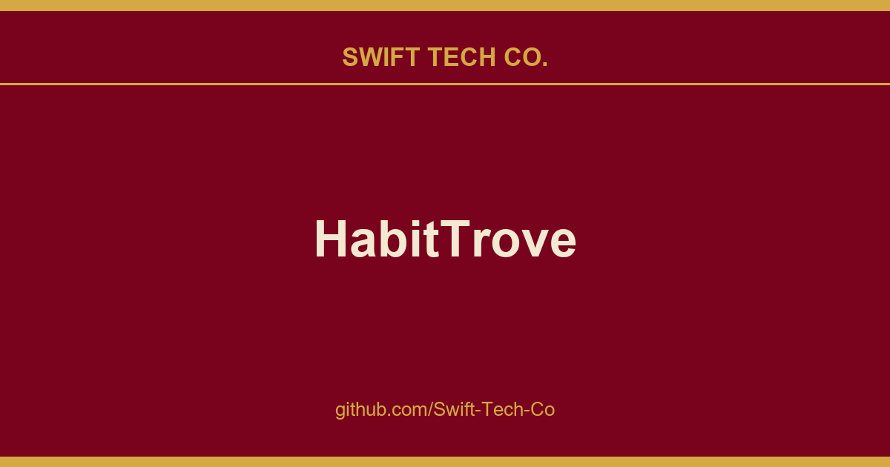

# HabitTrove

## What This Is

This is part of the Swift Tech Co. working stack for product and engineering. It gathers the HabitTrove notes, examples and fixes that keep delivery fast, and doubles as the reference map we hand to whoever picks up this thread next.

## Images

[](https://github.com/Swift-Tech-Co/HabitTrove)

## Try the Demo

Want to try HabitTrove before installing? Visit the public demo instance to experience all features without any setup required. (do not store personal info. Data on the demo instance is reset daily)

## Features

- 🎯 Create and track daily habits
- 🏆 Earn coins for completing habits
- 💰 Create a wishlist of rewards to redeem with earned coins
- 📊 View your habit completion streaks and statistics
- ✏️ Add freehand drawings to habits and wishlist items for visual reminders
- 📅 Calendar heatmap to visualize your progress (WIP)
- 🌍 Multi-language support (English, Español, Català, Deutsch, Français, Русский, 简体中文, 한국어, 日本語)
- 🌙 Dark mode support
- 📲 Progressive Web App (PWA) support
- 💾 Automatic daily backups with rotation

## Usage

1. **Creating Habits**: Click the "Add Habit" button to create a new habit. Set a name, description, and coin reward.

2. **Tracking Habits**: Mark habits as complete on your dashboard. Each completion earns you the specified coins.

3. **Wishlist**: Add rewards to your wishlist that you can redeem with earned coins.

4. **Statistics**: View your progress through the heatmap and streak counters.

## Docker Deployment

HabitTrove can be run using Docker in several ways, depending on your needs:

### Using Pre-built Images

The easiest way to run HabitTrove is using our pre-built Docker images from DockerHub:

1. First, prepare the data directory with correct permissions:

```bash
mkdir -p data backups
chown -R 1001:1001 data backups # Required for the nextjs user in container
```

2. Then run using either method:

```bash
# Generate a secure authentication secret
export AUTH_SECRET=$(openssl rand -base64 32)
echo $AUTH_SECRET

# Using docker-compose (recommended)
## Update the AUTH_SECRET environment variable in docker-compose.yaml
nano docker-compose.yaml
## Start the container
docker compose up -d

# Or using docker run directly
docker run -d \
  -p 3000:3000 \
  -v ./data:/app/data \
  -v ./backups:/app/backups \ # Add this line to map the backups directory
  -e AUTH_SECRET=$AUTH_SECRET \
  dohsimpson/habittrove
```

Available image tags:

- `latest`: Stable release version, recommended for most users
- `vX.Y.Z` (e.g., `v0.1.4`): Specific version for reproducible deployments and rollbacks
- `dev`: Latest development build from the main branch, may contain unstable features

Choose your tag based on needs:

- Use `latest` for general production use
- Use version tags (e.g., `v0.2.9`) for reproducible deployments
- Use `dev` for testing new features

**Note on Volumes:** The application stores user data in `/app/data` and backups in `/app/backups` inside the container. The examples above map `./data` and `./backups` from your host machine to these container directories. Ensure these host directories exist and have the correct permissions (`chown -R 1001:1001 data backups`).

### Building Locally

If you want to build the image locally (useful for development):

```bash
# Build the Docker image
npm run docker-build

# Run the container
npm run docker-run
```

The application data will be persisted in the `data` directory in both cases.

## Building the Project

To contribute to HabitTrove, you'll need to set up a development environment. Here's how to get started:

### Prerequisites

- Node.js 20 or later
- npm package manager
- Git (for version control)
- bun (for running tests)

### Setting Up the Development Environment

1. Clone the repository and navigate to the project directory:

```bash
git clone https://github.com/Swift-Tech-Co/HabitTrove
cd habittrove
```

2. Install project dependencies:

```bash
npm install --force
```

3. Set up the development environment:

```bash
npm run setup:dev
```

4. Start the development server:

```bash
npm run dev
```

5. Open https://github.com/Swift-Tech-Co/HabitTrove in your browser to access the development version.

### Running Tests

Before contributing, make sure to run the test suite:

```bash
npm test
```

### Building for Production

To build the project for production:

```bash
npm run build
```

This will create an optimized production build in the `.next` directory.

### Code Quality Tools

The project uses several tools to maintain code quality:

- ESLint for linting: `npm run lint`
- TypeScript type checking: `npm run typecheck`

Run these commands regularly during development to catch issues early.

## Contributing

We welcome feature requests and bug reports! Please open an issue. We do not accept pull request at the moment.

## License

This project is licensed under the GNU Affero General Public License v3.0 - see the [LICENSE](LICENSE) file for details.

## Support

If you encounter any issues or have questions, please file an issue on the GitHub repository.

---

## Swift Tech Co.

Built and maintained by Swift Tech Co.

AI Automation | FinTech Platforms | Custom Software and Mobile Apps | SaaS Platforms | Cloud Infrastructure | Cybersecurity | SEO and Marketing | API Integration

**Join our community on Telegram:** [t.me/+Qt_eFvkb2rliMzNh](https://t.me/+Qt_eFvkb2rliMzNh)

Home | Services | Careers | Referral Program | Influencers | About | Contact

**Connect**

- Website: https://github.com/Swift-Tech-Co/HabitTrove
- LinkedIn: [linkedin.com/in/stephenoladoke](https://www.linkedin.com/in/stephenoladoke/)
- LinkedIn (Company): [linkedin.com/company/swift-tech-co](https://www.linkedin.com/company/swift-tech-co)
- X: [@MrOladoke](https://x.com/MrOladoke)
- Instagram: [@mr.oladoke](https://www.instagram.com/mr.oladoke/)
- Instagram (Company): [@swifttechco](https://www.instagram.com/swifttechco/)
- Organization: [github.com/Swift-Tech-Co](https://github.com/Swift-Tech-Co)

## Sources

Compiled and maintained from upstream [dohsimpson/HabitTrove](https://github.com/dohsimpson/HabitTrove) under permissive open-source license.

---

Maintained by [Swift Tech Co.](https://github.com/Swift-Tech-Co) - [Telegram](https://t.me/+Qt_eFvkb2rliMzNh)

## Sources

Compiled and maintained from upstream [dohsimpson/HabitTrove](https://github.com/dohsimpson/HabitTrove) under permissive open-source license.

---

Maintained by [Swift Tech Co.](https://github.com/Swift-Tech-Co) - [Telegram](https://t.me/+Qt_eFvkb2rliMzNh)

## Sources

Compiled and maintained from upstream [dohsimpson/HabitTrove](https://github.com/dohsimpson/HabitTrove) under permissive open-source license.

---

Maintained by [Swift Tech Co.](https://github.com/Swift-Tech-Co) - [Telegram](https://t.me/+Qt_eFvkb2rliMzNh)